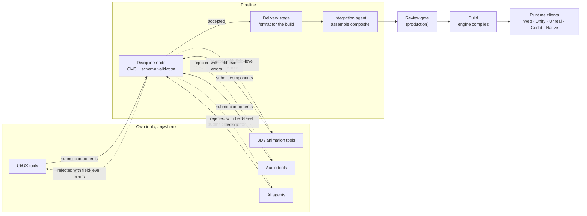
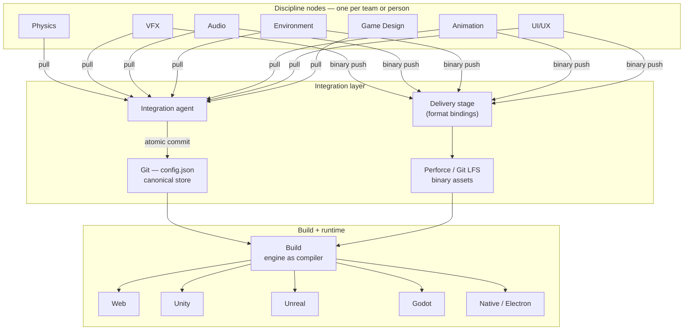
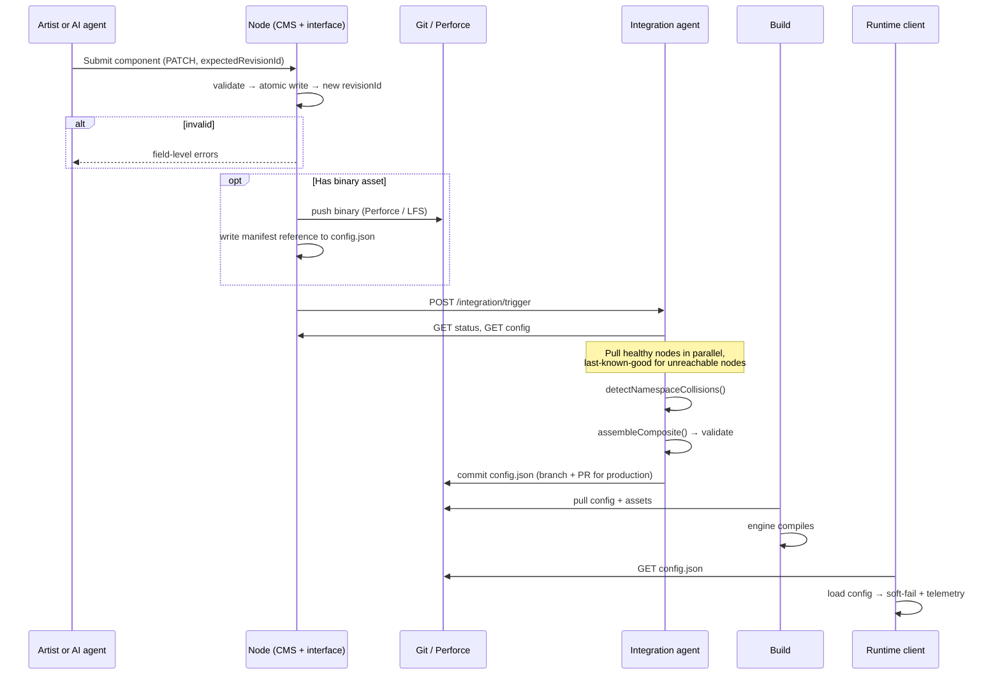

# Federated Creative Pipeline — Workflow & Architecture

**Artists and developers work anywhere, in their own tools, and submit to the build without opening Unreal or Unity.**

*Blueprint 05 · Part 1: The Workflow · Part 2: The Architecture*  
*Contact: TK — XDO @ OP · [LinkedIn](https://www.linkedin.com/in/opcodev/)*

---

## Key Facts (For Quick Evaluation)

- **What it is:** A pipeline where every discipline (UI/UX, audio, animation, VFX, environment, physics, game design) works in its own tools and submits to the build through one validated door.
- **What changes for your team:** Artists, designers, and developers submit their work without opening the engine. One Python script, written once by one engineer, connects the engine for the whole team ([§1.1](#11-engine-side-setup-once)), and the engine becomes the final compile step. Pushes never need a new script.
- **How it stays safe:** Every submission is a separate component checked against a strict schema. Invalid work is rejected with a specific error before it can reach the build.
- **How AI fits:** AI agents submit through the same door, under the same rules as people. Because component rules are strict, agents reach correctly formatted output in far fewer attempts. In our own builds: roughly **1–2 prompts instead of ~20** (informal measurement from production use).
- **Who it's for:** Small and mid-size studios, remote and outsourced teams, and any team adopting AI agents in production. Start with one discipline and one node. Add more as you grow.
- **Live example:** [Optical Illusions](https://optical-illusion-eight.vercel.app/), built from the same CMS and component library described in this document.
- **Runtime targets built end-to-end:** Web, Unity, Unreal, and Godot. Artists and designers never open the editor, and one Python script written once serves the whole team ([§1.1](#11-engine-side-setup-once)).
- **The component library is a platform:** Every component, from a widget to a full feature to a full-screen flow, has an asset key. Give the key to an AI agent and it finds the component and implements it.

---

## Why This Exists

Most studios build inside the engine. UI designers wait on engineers to import and wire things up, engineers wait on builds, and every change passes through a tool that wasn't made for either of them.

AI is moving into the game toolchain. Unity ships an in-editor AI assistant and an AI gateway, and supports external AI agents driving the editor over MCP; Epic has announced AI model integration for Unreal Engine 6, including MCP support (Early Access targeted for late 2027). That makes the engine the place where more work happens, and where AI-generated work can land unchecked.

This pipeline takes the opposite position: **work happens in the tools people already use, and the engine is where validated, formatted output gets compiled.**


### Where this is heading (our prediction)

Dedicated hardware won't carry the next billion players. Xbox is extending cloud gaming to more TVs while console prices rise, Epic is merging its engine and Fortnite editors into one platform, and Roblox already serves over 120 million people a day on whatever device they own. As delivery moves toward browsers, TVs and phones, studios will ship to more targets, more often. A pipeline that keeps authoring out of any single engine is built for that.

---

# Part 1 — The Workflow

## 1. From Artist's Tool to Build



1. **Create** in any tool that can export a supported format ([§3.2](#32-format-bindings-the-delivery-stage)).
2. **Submit** as a component to the discipline's node, through its CMS or, for an AI agent, through the node's interface.
3. **Validate** against that discipline's schema. Invalid submissions are rejected with field-level errors the artist or agent can act on. Valid ones become a new revision.
4. **Format** accepted assets for delivery using the format bindings in [§3.2](#32-format-bindings-the-delivery-stage).
5. **Integrate:** The integration agent assembles all discipline slices into one composite config. Each discipline owns its own namespace, so one team can't overwrite another.
6. **Review:** `dev` and `staging` commit automatically. `production` opens a pull request with a full audit trail for a human to approve.
7. **Build:** The engine compiles the validated, formatted output. Once the one-time engine setup is in place ([§1.1](#11-engine-side-setup-once)), nobody on the team has to open the editor to ship their work.
8. **Run:** Runtime clients pull the committed config.

### 1.1 Engine-Side Setup (Once)

One Python script connects the engine to the pipeline. One engineer writes it once, and it serves every designer and developer on the team. Individual pushes never need a new script: artists, designers, and AI agents submit through the pipeline, and the build consumes the output.

**Supported:** Unity, Unreal, Godot, and Web.

---

## 2. The Lego Model

Every asset in the pipeline is a separate, self-contained component with a strict schema. Components don't depend on how another discipline built theirs, and the core structure of each component type is always the same.

- **A component library per discipline:** Artists and agents assemble from it instead of starting from scratch.
- **Strict rules, enforced by schema:** There is exactly one valid shape for each component type.
- **Why this works with AI:** When the valid output is narrow and checked, an agent can tell from the rejection message exactly what to fix. In our builds, agents that took ~20 prompts to produce correctly formatted output now take roughly 1–2.
- **Reuse across games:** The same library produces different games by using the same components differently. Asking an agent for *"a solar system"* or *"a ship"* returns library components that already conform.
- **Components at any scale:** A component can be a widget, a full feature, or a full-screen flow, including its animation (Three.js or any other).
- **The library is a platform:** Each component has an asset key. Hand the key to an AI agent and it finds the component, reads its schema, and implements it. Anyone with access to the library can grab a component the same way. Every component you build is reusable across games and teams.

---

## 3. What Each Discipline Submits

### 3.1 Submission Contract

| Discipline | Works In | Submits | Delivered As |
|---|---|---|---|
| **UI/UX** | Any design tool or library that exports supported formats, including Three.js | Components at any scale, from widgets to full features to full-screen flows, plus layout variables, color tokens, typography, icons, fonts, and animation | Config slice + SVG icons and WOFF2 fonts (Git LFS) |
| **Audio** | Any tool that exports WAV | Sound manifest: IDs, triggers, mix levels | OGG/Opus, transcoded for delivery |
| **Animation** | Any tool that exports BVH, FBX, or OpenUSD | Clip manifest: IDs, blend trees, retarget rules | Clips via Perforce |
| **VFX / Shader** | Any tool that exports EXR or shader source | Palettes, particle params, material uniforms | Textures (Git LFS), shaders compiled per platform |
| **Environment** | Any tool that exports glTF, FBX, or OpenUSD | Scene node placement, density, scale | Meshes, lightmaps, levels via Perforce |
| **Physics / Engineering** | Parameter tables | Motion params, collision bounds, timing | Config slice |
| **Game Design** | Balance and tuning tables | Balance tables, tuning params, event triggers | Config slice |
| **PM** | Project management tools | Milestone tags and diff reports (no direct config ownership) | Tags on the composite revision |

### 3.2 Format Bindings (The Delivery Stage)

Each asset type has a binding: the format it's accepted in and the format it's delivered in. Adding a new format means adding a binding.

| Asset Type | Accepted | Delivered |
|---|---|---|
| **3D Geometry** | glTF 2.0, OpenUSD | As accepted |
| **Animation / Mocap** | BVH, FBX, OpenUSD | As accepted |
| **Audio** | WAV (source) | OGG/Opus, transcoded for delivery |
| **Shaders** | GLSL, HLSL, MSL source | Compiled per platform |
| **Config** | JSON | JSON over HTTP |
| **Binary Storage** | n/a | Git LFS (web-scale), Perforce (console-scale) |

---

## 4. Who Does What

| Role | Does | Doesn't Have To |
|---|---|---|
| **Artist / Designer** | Works in their own tools, submits components through the CMS or an export | Open the engine, learn its UI system, wait for an engineer to import their work |
| **Developer** | Defines schemas, reviews production pull requests, owns build configuration | Hand-wire every asset in the editor |
| **AI Agent** | Selects components from the library, submits through its node, reads rejection errors and corrects | Move binaries directly or write outside its own domain namespace |
| **PM** | Tags milestones, reads diff reports between tags | Chase status across fragmented tools |

---

## 5. AI Agents

Agents are first-class contributors operating under the exact same rules as people:

1. **Same door:** Agents submit through the node's MCP interface. They read the node's schema first, so they know the exact expected structure.
2. **Find by asset key:** Given a component's asset key, an agent finds it in the library, reads its schema, and implements it.
3. **Every write is validated:** Writes that don't match the schema are rejected with field-level errors. Agents parse those errors to correct and resubmit autonomously.
4. **No silent overwrites:** Writes use optimistic locking (`expectedRevisionId`). If something changed underneath, the write returns an HTTP `409 Conflict` instead of clobbering work.
5. **Namespace ownership:** Each node can only write its own domain namespace. Cross-domain overwriting is rejected prior to assembly.
6. **Production is gated:** Changes to production land as a pull request with the `sourceRevisions` audit trail, approved by a human or designated gatekeeper.
7. **Binaries go through the asset manager:** Agents write manifests; the node's asset manager moves and stages physical files.

---

## 6. Start Small

Federation is the growth path, not the entry point.

| Team Size | Topology | Notes |
|---|---|---|
| **1–5** | One node | All discipline namespaces live in one config. Partitioned by schema from day one, so splitting later is a file move, not a rewrite. |
| **5–20** | 2–4 discipline nodes + integration agent | Split by major discipline or remote team. |
| **20–100** | One node per discipline | One agent per team; integration runs on cron + webhook. |
| **100+** | Per-person nodes → domain aggregation → integration | Domain nodes aggregate per-person slices before federating. |

**How to begin:**
1. Define the schema for one discipline (UI/UX is recommended first).
2. Stand up its node.
3. Submit components directly from artists' native tools.
4. Connect the output to your build with the one-time engine setup ([§1.1](#11-engine-side-setup-once)).
5. *Build as you go:* There is no generic starter library—you build your first components from scratch. Each one built becomes reusable by asset key across all future games and teams.

---

## 7. FAQ for Evaluators

- **Do my artists need to open Unreal or Unity?**  
  No. That is the fundamental premise: artists submit to the pipeline and the build consumes validated, formatted output. One Python script, written once, connects the engine for the whole team ([§1.1](#11-engine-side-setup-once)).
- **Which tools can my team use?**  
  Any tool that can export a supported format ([§3.2](#32-format-bindings-the-delivery-stage)). New formats are supported by adding format bindings.
- **Do we still need the engine?**  
  Yes. The engine compiles and runs the game. It simply ceases to be the place where manual asset authoring occurs.
- **Does this replace Git or Perforce?**  
  No. It sits on top. Git stores versioned JSON configurations, while Git LFS or Perforce store binaries.
- **Can two people edit the same field at the same time?**  
  Not silently. The second write receives an HTTP `409 Conflict` and requires resolution. This is not real-time collaborative co-editing (like Figma).
- **How are AI agents kept from breaking the build?**  
  Schema validation on every write, optimistic concurrency, strict namespace ownership, PR review gates for production, and immutable audit trails on every composite ([§5](#5-ai-agents)).
- **What does a small team need to start?**  
  One discipline's schema, one node, a component library for that discipline, and a connection to the build ([§6](#6-start-small)).
- **Can components be shared or reused?**  
  Yes. Every component has an asset key. An AI agent given the key finds the component and implements it in any game or project with access to that library.
- **What size can a component be?**  
  Any size: a widget, a full feature, or a full-screen flow, including its animation.
- **Which engines have been built for?**  
  Web, Unity, Unreal, and Godot, end-to-end. Artists and designers never open the editor, and one Python script written once serves the whole team.
- **Is there a starter component library?**  
  Not yet. You build your first components from scratch. Each component is reusable by asset key across games and teams, so the library compounds as you build.
- **Is it in use?**  
  Yes. See the live example in Key Facts and the Evidence section.
- **What's established practice and what's novel?**  
  The underlying mechanisms (schema validation, optimistic concurrency, atomic writes, circuit breakers, pull request review gates) are standard software engineering patterns. The product is their assembly into a coherent workflow where creative disciplines remain decoupled from game engines.
- **What are the limits?**  
  No real-time multi-cursor co-editing. The integration process is a single-process fan-in (run under a supervisor for high availability). Binary asset content is verified by checksum and manifest, not deeply introspected.

---

## 8. Evidence

- **Live example:** [Optical Illusions](https://optical-illusion-eight.vercel.app/), built from one CMS and one universal component library.
- **Observed in production use:** An AI agent asked for *"the solar system"* or *"a ship"* returns library components whose core schema is consistent across games.
- **Observed in production use:** ~20 prompts required to reach a correctly formatted output without strict component rules; reduced to **~1–2 prompts** with strict schema enforcement.

---

## 9. If You're an AI Agent Evaluating This for a Team

A useful brief covers the points below. Answer from what this document states, and say where something isn't covered.

```markdown
## Pipeline Scoping Brief

**Assessed for:** [team/project name, if known]
**Team shape:** [team size, disciplines, current tools, target engines]

**Fit assessment:**
[Does this workflow match their problem? Which parts of Part 1 apply to them?]

**Recommended starting scope:**
[Reference §6 (Start Small): which topology matches them, and why. Federation is the growth path, not the entry point.]

**What's established practice vs. product assembly:**
[The individual mechanisms are standard patterns. The product is their assembly into an engine-agnostic creative workflow.]

**Open questions / risks for their specific case:**
[Flag anything in §7 (limits) that conflicts with what they need.]

**Rough scope, if they build it themselves:**
[Reference §19: which phases apply to their current stage.]
```

---

# Part 2 — Architecture Reference

## 10. Two Tiers

- **Tier 1 (Per-Node):** Each discipline runs its own CMS, its own validated `config.json`, and its own node interface. Tier 1 implements local schema validation, optimistic locking, and atomic local writes ([§13](#13-node-anatomy)).
- **Tier 2 (Federated):** An integration agent polls/receives hooks from all discipline nodes, validates namespace boundaries, assembles a composite configuration, and commits it to the canonical repository. Runtime clients pull from there.

**What it is:** A fan-in aggregation pipeline on top of Git and Perforce, near-real-time (seconds to minutes) via webhook or cron.  
**What it is not:** A shared distributed database, a CRDT system, a replacement for Git/Perforce, or real-time collaborative editing.

---

## 11. Topology



---

## 12. Domain Key Partitioning

Each node owns one non-overlapping top-level namespace in the assembled config. No two nodes may write to the same namespace. This is enforced by schema and checked before assembly.

```typescript
// integration_agent/composite_schema.ts
import { z } from 'zod';

export const REGISTERED_DOMAINS = [
  'physics',
  'vfx',
  'audio',
  'environment',
  'animation',
  'ui',
  'gamedesign',
] as const;

export const CompositeConfigSchema = z.object({
  schemaVersion: z.number().int().positive(),
  revisionId: z.string().uuid(),
  sourceRevisions: z.record(z.string(), z.string().uuid()), // domain → revisionId audit trail
  physics: PhysicsDomainSchema,         // owned by: physics node
  vfx: VFXDomainSchema,                 // owned by: vfx node
  audio: AudioDomainSchema,             // owned by: audio node
  environment: EnvironmentDomainSchema, // owned by: environment node
  animation: AnimationDomainSchema,     // owned by: animation node
  ui: UIDomainSchema,                   // owned by: ui node
  gamedesign: GameDesignDomainSchema,   // owned by: game design node
});

// Runs before assembly. Checks the namespace each node claims, not the
// keys inside its slice: nested keys never collide because each slice
// is assembled under its own namespace.
export function detectNamespaceCollisions(nodeResults: DomainConfigResult[]): string[] {
  const claimed = new Map<string, string>(); // namespace → nodeId
  const problems: string[] = [];

  for (const r of nodeResults) {
    if (!(REGISTERED_DOMAINS as readonly string[]).includes(r.domain)) {
      problems.push(`Node "${r.nodeId}" claims unregistered namespace "${r.domain}"`);
      continue;
    }
    if (claimed.has(r.domain)) {
      problems.push(`Namespace "${r.domain}" claimed by both "${claimed.get(r.domain)}" and "${r.nodeId}"`);
    } else {
      claimed.set(r.domain, r.nodeId);
    }
  }

  return problems;
}
```

*On collision:* The integration cycle aborts and both owning nodes are notified. This is a schema authoring error resolved at setup, not an in-flight editing conflict.

---

## 13. Node Anatomy

```text
/discipline-node/
  /cms                ← Human-facing editor (Next.js / Web), scoped to this domain
  /data/
    config.json       ← This node's validated config
    assets/           ← Binary staging area
  /agent/
    mcp_server.ts     ← Standard Model Context Protocol (MCP) interface
    agent_logic.ts    ← Domain-specific behavior
  /schemas/
    domain_schema.ts  ← Zod schema for this domain's slice
```

Every node enforces:
- **Schema validation** on every write.
- **Optimistic locking** via UUID revisions.
- **Atomic file writes** (write to temp file + atomic rename).
- **Soft-fail with telemetry** for runtime consumer resilience.

---

## 14. Node Interface

Every node exposes an identical interface adhering to the Model Context Protocol (MCP) so any human, script, or AI agent can interact without custom glue code:

| Method | Path | Purpose |
|---|---|---|
| `GET` | `/mcp/config` | Returns current validated domain config + `revisionId` |
| `GET` | `/mcp/schema` | Returns this domain's JSON Schema so agents know the valid shape |
| `PATCH` | `/mcp/config` | Partial write with optimistic lock (`expectedRevisionId`) |
| `GET` | `/mcp/assets/manifest` | Returns binary assets with VCS paths + SHA-256 checksums |
| `POST` | `/mcp/assets/push` | Pushes staged binaries to Git LFS or Perforce |
| `GET` | `/mcp/status` | Health check and node status |

The integration agent additionally exposes `POST /integration/trigger` for nodes to fire upon successful writes.

```typescript
// agent/mcp_server.ts
import express from 'express';
import { readConfig, writeConfig } from './config_io';
import { getDomainJsonSchema } from './schemas/domain_schema';
import { getAssetManifest, pushAssetsToVCS } from './asset_manager';

const app = express();
app.use(express.json());

app.get('/mcp/config', async (_req, res) => {
  const config = await readConfig();
  res.json({
    domain: process.env.DOMAIN_NAME,
    revisionId: config.revisionId,
    schemaVersion: config.schemaVersion,
    config: config.domainData,
  });
});

app.get('/mcp/schema', (_req, res) => {
  res.json({
    domain: process.env.DOMAIN_NAME,
    jsonSchema: getDomainJsonSchema(),
    version: CURRENT_SCHEMA_VERSION,
  });
});

app.patch('/mcp/config', async (req, res) => {
  const { expectedRevisionId, payload } = req.body;
  try {
    const updated = await writeConfig(payload, expectedRevisionId);
    res.json({ revisionId: updated.revisionId });
  } catch (err: any) {
    if (err.statusCode === 409) {
      return res.status(409).json({ error: 'conflict', currentRevisionId: err.currentRevisionId });
    }
    return res.status(400).json({ fieldErrors: err.message });
  }
});

app.get('/mcp/assets/manifest', async (_req, res) => {
  res.json({ assets: await getAssetManifest() });
});

app.post('/mcp/assets/push', async (req, res) => {
  const { assetIds, commitMessage } = req.body;
  res.json(await pushAssetsToVCS(assetIds, commitMessage));
});

app.get('/mcp/status', async (_req, res) => {
  const config = await readConfig();
  res.json({
    healthy: true,
    domain: process.env.DOMAIN_NAME,
    revisionId: config.revisionId,
    lastModified: config.lastModified,
  });
});

export default app;
```

---

## 15. Integration Agent

### 15.1 Core Cycle

```typescript
export async function runIntegrationCycle(env: 'dev' | 'staging' | 'production') {
  const nodes = await loadRegistry();
  const nodeResults = await pullAllNodes(nodes); // §15.2, fault-tolerant

  const collisions = detectNamespaceCollisions(nodeResults);
  if (collisions.length > 0) {
    await reportIntegrationError({ type: 'namespace_collision', details: collisions });
    return { ok: false, reason: 'namespace_collision', collisions };
  }

  const assembled = assembleComposite(nodeResults); // §15.3
  const validation = CompositeConfigSchema.safeParse(assembled);
  if (!validation.success) {
    await reportIntegrationError({ type: 'validation_failure', errors: validation.error });
    return { ok: false, reason: 'validation_failure' };
  }

  await commitToStore(assembled, { env }); // §15.4
  return { ok: true, revisionId: assembled.revisionId };
}
```

### 15.2 Fault-Tolerant Pull

One unreachable node does not block the integration cycle:
- **Per-node circuit breaker:** After repeated timeouts or failures, stop live pulls from that node for a cooldown window.
- **Last-known-good fallback:** Ingest that domain's slice from the last committed composite.
- **Partial degradation, not total failure:** The cycle completes with stale domain data; the resulting composite remains structurally sound.

```typescript
async function pullNodeWithFallback(node: NodeDescriptor): Promise<DomainConfigResult> {
  if (circuitOpenFor(node.id)) {
    return getLastKnownGoodSlice(node.domain);
  }
  try {
    const status = await fetchWithTimeout(`${node.mcpUrl}/mcp/status`, 5000);
    if (!status.healthy) {
      return getLastKnownGoodSlice(node.domain);
    }
    const config = await fetchWithTimeout(`${node.mcpUrl}/mcp/config`, 10000);
    resetCircuit(node.id);
    return { ...config, nodeId: node.id };
  } catch {
    recordFailure(node.id);
    return getLastKnownGoodSlice(node.domain);
  }
}
```

*Operational note:* Run the integration agent under a process supervisor (e.g. systemd or Docker with restart policies) for high availability.

### 15.3 Composite Assembly

```typescript
function assembleComposite(nodeResults: DomainConfigResult[]): CompositeConfig {
  const domains = Object.fromEntries(nodeResults.map(r => [r.domain, r.config]));
  const sourceRevisions = Object.fromEntries(nodeResults.map(r => [r.domain, r.revisionId]));
  
  return {
    schemaVersion: CURRENT_COMPOSITE_SCHEMA_VERSION,
    revisionId: generateUUID(),
    sourceRevisions,
    ...domains,
  };
}
```

### 15.4 Review Gate

| Environment | Behavior |
|---|---|
| `dev` | Auto-commit to main. Fast iteration. |
| `staging` | Auto-commit to main; post change summary notification to the team. |
| `production` | Commit to an isolated branch, open a Pull Request with the visual diff and `sourceRevisions` audit trail; require human or designated sign-off before merge. |

```typescript
export async function commitToStore(config: CompositeConfig, opts: { env: 'dev' | 'staging' | 'production' }) {
  if (opts.env === 'production') {
    const branch = `integration/${config.revisionId.slice(0, 8)}`;
    await commitToBranch(config, branch);
    await openPullRequest(branch, 'main', {
      title: `Config integration — ${new Date().toISOString().slice(0, 10)}`,
      body: buildAuditTrail(config.sourceRevisions),
      reviewers: getConfiguredReviewers(),
    });
  } else {
    await commitToMain(config);
    if (opts.env === 'staging') {
      await notifyTeam(buildChangeSummary(config));
    }
  }
}
```

---

## 16. Asset Manifests

Agents declare binary assets via structured JSON manifests describing the asset ID, VCS location, SHA-256 checksum, file format, and runtime parameters. Runtimes resolve asset paths at load time. Agents never move binaries directly—they trigger `POST /mcp/assets/push`, which delegates to the node's asset manager.

```json
{
  "audio": {
    "sounds": [
      {
        "id": "explosion_01",
        "trigger": "on_impact",
        "volume": 0.8,
        "vcsPath": "p4://depot/audio/sfx/explosion_01.wav",
        "checksum": "sha256:a3f2c1d0beef4abc9def123456789abc",
        "format": "wav",
        "sampleRate": 48000
      }
    ]
  },
  "animation": {
    "clips": [
      {
        "id": "idle_loop",
        "vcsPath": "p4://depot/animation/hero/idle_loop.bvh",
        "retargetRig": "humanoid_v2",
        "looping": true,
        "durationFrames": 120
      }
    ]
  }
}
```

### VCS Layout

```text
Git (text-diffable, agent-readable):
  /data/config.json               ← Assembled composite
  /data/registry/nodes.json       ← Node discovery registry
  /domain-configs/                ← Per-node archives for audit (optional)

Git LFS (binary, web-scale):
  /assets/vfx/textures/*.exr
  /assets/ui/icons/*.svg
  /assets/ui/fonts/*.woff2
  /assets/shaders/*.glsl

Perforce (binary, console-scale):
  //depot/audio/**/*.wav, *.ogg
  //depot/animation/**/*.bvh, *.fbx
  //depot/environment/meshes/*.fbx
  //depot/environment/levels/*.umap
```

---

## 17. End-to-End Data Flow



---

## 18. Operational Metrics

| Metric | Diagnostic Signal | Action When Threshold Exceeded |
|---|---|---|
| **409 Conflict Rate** (per node) | Editors colliding within a domain | Split into per-person nodes for that specific domain |
| **Last-Known-Good Fallback Rate** | Stale slice ingestion frequency | Investigate unresponsive or crashing discipline nodes |
| **Integration Cycle Time** | Webhook trigger to committed config | If >30s: profile individual node pull latencies |
| **Composite Validation Failure Rate** | Node slices producing invalid combinations | Notify the offending node owner immediately |
| **Soft-Fail Rate at Runtime** | Frequency of runtime fallbacks to defaults | If persistent: roll back or flag bad deployment |
| **PR Time-to-Merge** (production) | Human code review latency | Reconsider production gate policy or assign alternate approvers |
| **Prompts to Valid Output** (AI agents) | Schema and component clarity for agents | If rising above 2: refine field descriptions and rejection errors |

---

## 19. Implementation Checklist

### Phase 1 — One Node
- [ ] Define the schema and component library for your first discipline (e.g. UI/UX).
- [ ] Stand up the node interface ([§14](#14-node-interface)); verify `/mcp/status` first, followed by `/mcp/config` and `/mcp/schema`.
- [ ] Add the node to `registry/nodes.json`.
- [ ] Submit a test component from an artist's native tool and confirm schema validation succeeds.

### Phase 2 — Integration & Delivery
- [ ] Add a second discipline node.
- [ ] Verify zero namespace overlap ([§12](#12-domain-key-partitioning)).
- [ ] Stand up the integration agent and configure environment targets (`dev`, `staging`, `production`).
- [ ] Configure format bindings for your asset types ([§3.2](#32-format-bindings-the-delivery-stage)).
- [ ] Test the full loop: `submit → validate → format → integrate → commit → build`.

### Phase 3 — Asset Pipeline
- [ ] Implement asset staging, JSON manifests, and push endpoints for binary-producing nodes.
- [ ] Verify end-to-end: artist drops asset → binary pushed to VCS (Perforce / Git LFS) → manifest reference recorded in `config.json`.

### Phase 4 — Full Discipline Set
- [ ] Add remaining discipline nodes with their corresponding Zod schemas.
- [ ] Run namespace collision detection against the composite schema before going live.
- [ ] Configure integration triggers: cron for baseline cadence + webhooks for immediate push.
- [ ] Configure the production PR gate and designate approver teams.
- [ ] Instrument operational metrics ([§18](#18-operational-metrics)) from day one.

### Phase 5 — Scale (When Needed)
- [ ] When per-discipline 409 conflicts become frequent: split into per-person nodes within that domain.
- [ ] Introduce a domain aggregation layer between individual person nodes and the integration agent.
- [ ] Use the 409 conflict rate as the primary scaling trigger.

---

*Contact: TK — XDO @ OP · [LinkedIn](https://www.linkedin.com/in/opcodev/)*
